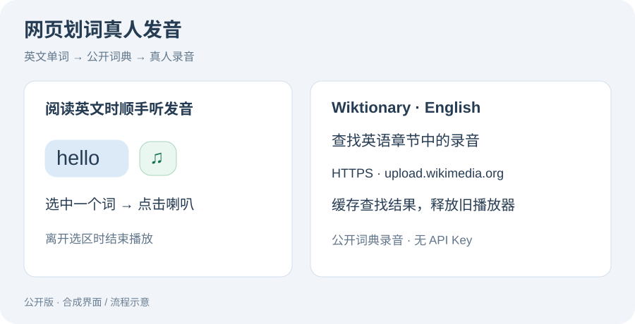

# 网页划词真人发音

**选中网页中的一个英文单词，点击喇叭，播放 Wiktionary 收录的真人录音。** 适合阅读时查发音。



JavaScript · Tampermonkey · MediaWiki API · Audio · 异步状态管理

## 使用

1. 安装支持 `GM_xmlhttpRequest` 的用户脚本管理器，例如 Tampermonkey。
2. 新建脚本，粘贴 [real-human-pronunciation.user.js](real-human-pronunciation.user.js) 并保存。
3. 刷新普通网页，选中一个英文单词，点击喇叭。

只支持单个英文词及常见连字符、撇号形式。需要访问 Wiktionary 和 Wikimedia；部分单词没有录音。选择变化、滚动或窗口失去焦点会结束当前播放。

## 实现与修复

- 使用 Wiktionary 的公开解析接口查找音频，以 Wikimedia 文件为播放来源。
- 限定英语章节，兼容裸 `h2` 和 MediaWiki 标题包装结构，避免其他语言的 MP3 抢占英语录音。
- 严格校验 HTTPS 和 `upload.wikimedia.org` 主机；拒绝仿冒域名与带凭据的链接。
- 选择变化后使旧查找、下载及播放回调失效，旧音频结束事件不会停止新音频。
- 播放失败或结束时回收 Blob URL；网络查询和音频下载均有超时。
- 缓存最多 128 个词；成功缓存 6 小时，未找到录音缓存 1 分钟。
- 封闭 Shadow DOM 和真实点击检查，页面脚本不能通过合成按钮点击发起查询。

## 检查

```sh
npm ci
npm test
```

Node.js 24 + JSDOM；覆盖跨语言音频选择、两种标题结构、URL 校验、过期请求、播放器回调与资源回收。测试全部使用模拟接口，不下载真实音频。

已通过离线回归。公开词典的 HTML 结构和音频格式可能变化；真实网络与用户脚本管理器环境还需要使用者验证。图片为界面示意。

## 项目来源

个人英文阅读辅助脚本，使用 AI 辅助开发。代码采用 MIT；外部录音遵循各 Wikimedia 文件页面所注明的许可，仓库未打包这些录音。

[Wiktionary](https://en.wiktionary.org/) · [作品集首页](https://github.com/WULUWA-233/computer-portfolio)
